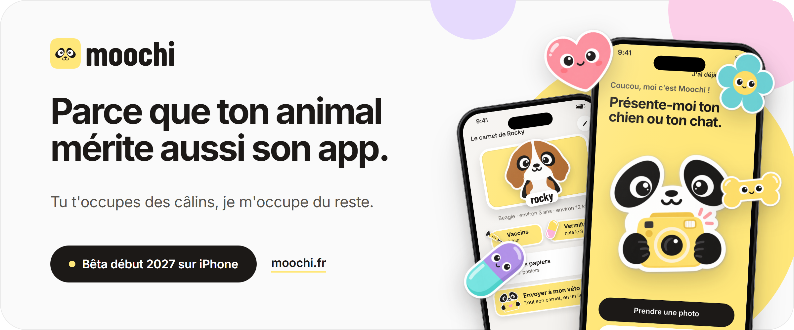
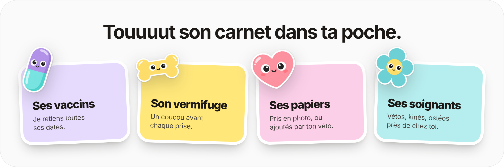

  <a href="https://moochi.fr"><b>moochi.fr</b></a> &nbsp;·&nbsp;
  <a href="https://moochi.fr/blog">Le blog</a> &nbsp;·&nbsp;
  <a href="https://moochi.fr/#faq">Questions fréquentes</a> &nbsp;·&nbsp;
  <a href="https://moochi.fr/#liste-attente">Rejoindre la liste d'attente</a>

Moochi est le carnet de santé numérique de ton chien ou ton chat, sur iPhone : vaccins, soins à venir, papiers et vétos près de chez toi. **La bêta est prévue début 2027.**

 

## Bon à savoir

- **iPhone d'abord.** Moochi arrive sur iOS 18 ou plus récent. Pas d'Android pour l'instant.
- **Chiens et chats.** Un carnet pour chacun. Les autres animaux sont à l'étude.
- **Un complément, pas un remplaçant.** Le passeport européen et les documents de ton vétérinaire restent les documents officiels, et seul un vétérinaire peut poser un diagnostic.

La bêta arrive début 2027. [Inscris-toi à la liste d'attente](https://moochi.fr/#liste-attente) sur moochi.fr, ou lis [le blog](https://moochi.fr/blog) en attendant. Une question ? La [FAQ](https://moochi.fr/#faq) y répond.

  © 2026 Moochi

